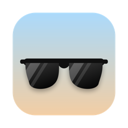

<p align="center">
  
</p>

<h1 align="center">XREAL Anchor for macOS</h1>

<p align="center">
  Pin your XREAL glasses' screen in place on macOS. Free and open source.<br>
  ล็อคจอของแว่น XREAL ให้ลอยนิ่งอยู่กับที่บน Mac ใช้ฟรีและเป็นโอเพนซอร์ส
</p>

<p align="center">
  <a href="#ภาษาไทย">ภาษาไทย</a> · <a href="#english">English</a> ·
  <a href="https://github.com/BigBundit/xreal-anchor-mac/releases/latest">Download / ดาวน์โหลด</a>
</p>

---

## ภาษาไทย

### นี่คืออะไร

แว่น XREAL Air เมื่อต่อกับ Mac จะทำตัวเป็นจอธรรมดาที่ติดอยู่กับหน้า หันหัวไปทางไหน จอก็หันตามไปด้วย
**XREAL Anchor** อ่านเซนเซอร์ในแว่นแล้ววาดจอใหม่ให้ลอยนิ่งอยู่ในอากาศ (3DoF) เหมือนมีจอมอนิเตอร์ตั้งอยู่ตรงหน้า
หันไปทางอื่นจอก็อยู่ที่เดิม

### ความสามารถ

- 🔒 **3 โหมด:** ล็อคกับที่ / ตามนุ่มนวล (จอค่อยๆ ตามมาเมื่อหันไปไกล เหมาะตอนนั่งรถ) / ติดหัว
- 🖥️ **จอเสมือน** ที่ macOS มองเห็นเป็นจอจริง ลากหน้าต่างไปวางได้ตามปกติ รองรับ HiDPI (ตัวหนังสือคม)
  ตั้งความละเอียดได้ตั้งแต่ 1280×720 ถึง 3840×1080 (Ultrawide)
- 🌀 **จอโค้ง** และปรับขนาดจอได้ 15°–120°
- ⌨️ **คีย์ลัด 21 ตัว** ใช้ได้ทุกแอป มีป้ายแจ้งในแว่นทุกครั้งที่กด
- 🎯 **ภาพนิ่งที่สุดเท่าที่ทำได้บน macOS:** วัดเวลาที่ภาพขึ้นจอจริงทุกเฟรมแล้วทำนายตำแหน่งหัวให้ตรงเวลานั้น
  ใช้ late latching ชดเชยจุดหมุนคอ และชดเชย gyro drift อัตโนมัติ
- 🧰 **โหมดจูน:** แสดงกริดในแว่นแล้วปรับ FOV และการทำนายแบบสดๆ ได้
- 🔌 เสียบแว่นแล้วล็อคจอให้อัตโนมัติ และเปิดแอปเองตอนเข้าสู่ระบบได้

### รองรับ

| | |
|---|---|
| macOS | 14 Sonoma ขึ้นไป · ชิป Apple Silicon และ Intel |
| แว่น | XREAL Air (ทดสอบแล้ว) · Air 2 · Air 2 Pro · Air 2 Ultra (โปรโตคอลเดียวกัน แต่ยังไม่ได้ทดสอบ) |

แว่น XREAL One / One Pro ล็อคจอได้เองในตัวแว่นอยู่แล้ว ไม่จำเป็นต้องใช้แอปนี้

### ติดตั้ง

1. ดาวน์โหลด `XREAL-Anchor-x.x.x-macOS.zip` จาก [หน้า Releases](https://github.com/BigBundit/xreal-anchor-mac/releases/latest)
2. แตกไฟล์ แล้วลาก **XREAL Anchor.app** ไปไว้ในโฟลเดอร์ **Applications**
3. ดับเบิลคลิกเปิด ครั้งแรก macOS จะเตือนว่าตรวจสอบผู้พัฒนาไม่ได้ เพราะแอปไม่ได้ซื้อใบรับรองจาก Apple
   ให้ไปที่ **System Settings › Privacy & Security** เลื่อนลงไปแล้วกด **Open Anyway**
   หรือรันคำสั่งนี้แล้วเปิดใหม่:
   ```bash
   xattr -dr com.apple.quarantine "/Applications/XREAL Anchor.app"
   ```
4. เสียบแว่น แอปจะขอสิทธิ์ **Screen & System Audio Recording** ให้อนุญาต แล้ว**ปิดและเปิดแอปใหม่**
   (แอปใช้สิทธิ์นี้เพื่อจับภาพจอเสมือนของตัวเองเท่านั้น ไม่มีการส่งข้อมูลออกไปไหน)
5. ไอคอนแว่นกันแดดจะขึ้นบน menu bar ใส่แว่นแล้วกด **⌃⌥⌘R** เพื่อดึงจอมาไว้ตรงหน้า

### วิธีใช้

- **เลื่อนเมาส์ออกขอบขวาของจอ Mac** จะเข้าไปที่จอเสมือนในแว่น ลากหน้าต่างไปวางได้เลย
- คลิกไอคอน 👓 บน menu bar เพื่อตั้งค่า ทุกปุ่มมีป้ายคีย์ลัดติดอยู่

### คีย์ลัด

กด **⌃⌥⌘** (Control + Option + Command) ค้างไว้ แล้วกด:

| ปุ่ม | การทำงาน |
|---|---|
| **A** | เปิด/ปิดการล็อคจอ |
| **R** | ดึงจอมาตรงหน้า (Recenter) |
| **1 / 2 / 3** | โหมด ล็อคกับที่ / ตามนุ่มนวล / ติดหัว |
| **M** | สลับโหมดวนไป |
| **= / − / 0** | ขยาย / ย่อ / ขนาดจอเริ่มต้น |
| **C** | จอโค้ง / จอแบน |
| **↑ ↓ ← →** | เลื่อนจอทีละ 2° |
| **S** | เปิด/ปิดลดภาพสั่น |
| **G** | ปรับเทียบ Gyro |
| **T** | โหมดจูน (แสดงกริด) |
| **[ / ]** | ลด / เพิ่ม FOV |
| **, / .** | ลด / เพิ่มการทำนายการเคลื่อนไหว |

### ทำให้จอนิ่งที่สุด (โหมดจูน)

1. กด **⌃⌥⌘T** จะมีกริดสีเขียวขึ้นในแว่น
2. ส่ายหัวซ้าย-ขวาช้าๆ แล้วดูกริดเทียบกับของจริงในห้อง
   - กริดวิ่ง**ตาม**หัว → **⌃⌥⌘[** · กริดวิ่ง**สวน**หัว → **⌃⌥⌘]**
   - กริด**หน่วง**แล้วค่อยตาม → **⌃⌥⌘.** · กริด**เลยไป**แล้วเด้งกลับ → **⌃⌥⌘,**
3. กด **⌃⌥⌘T** อีกครั้งเพื่อปิด แอปจะจำค่าไว้ให้

### แก้ปัญหา

| อาการ | วิธีแก้ |
|---|---|
| จอค่อยๆ ลอยไปด้านข้าง | **⌃⌥⌘G** แล้ววางแว่นนิ่งบนโต๊ะ 3 วินาที |
| หันซ้ายแล้วจอไปผิดทาง | เมนู › ขั้นสูง › "กลับทิศซ้าย-ขวา" / "กลับทิศขึ้น-ลง" |
| ขึ้นว่าต้องอนุญาต Screen Recording ทั้งที่อนุญาตแล้ว | ลบ XREAL Anchor ออกจากรายการด้วยปุ่ม − แล้วเปิดแอปใหม่ หรือรัน `tccutil reset ScreenCapture com.big.xreal-anchor` |
| จอสั่น / กระตุก | ปิดแอปอื่นที่อ่านเซนเซอร์แว่นอยู่ แล้วลองโหมดจูน |
| ขยับตัวไปข้างๆ แล้วจอเลื่อนตาม | เป็นข้อจำกัดของแว่น 3DoF: แว่นรู้แค่การหมุนหัว ไม่รู้ตำแหน่ง |

Log อยู่ที่ `~/Library/Logs/XrealAnchor.log`

---

## English

### What it is

Plugged into a Mac, XREAL Air glasses act as a plain display strapped to your face. When you turn your head,
the picture turns with it. **XREAL Anchor** reads the glasses' motion sensor and redraws the screen so that it stays
put in space (3DoF), like a real monitor standing in front of you.

### Features

- 🔒 **Three modes:** Anchored, Smooth Follow (the screen glides after you once you look far away, good in a car),
  and Head-locked
- 🖥️ **Virtual display** that macOS treats as a real monitor. Drag windows onto it as usual. HiDPI for crisp text,
  resolutions from 1280×720 to 3840×1080 ultrawide
- 🌀 **Curved screen** and screen size from 15° to 120°
- ⌨️ **21 global shortcuts**, each confirmed by an on-screen badge inside the glasses
- 🎯 **As stable as macOS allows:** measures when each frame really reaches the display and predicts the head pose
  for that moment, with late latching, neck-pivot compensation and automatic gyro drift correction
- 🧰 **Tuning mode:** shows a grid in the glasses so you can adjust FOV and prediction live
- 🔌 Starts anchoring automatically when the glasses are plugged in. Can launch at login

### Requirements

| | |
|---|---|
| macOS | 14 Sonoma or later · Apple Silicon and Intel |
| Glasses | XREAL Air (tested) · Air 2 · Air 2 Pro · Air 2 Ultra (same protocol, not yet tested) |

XREAL One / One Pro glasses can anchor the screen by themselves and do not need this app.

> **Note:** the app's menus are currently in Thai. The shortcuts and the tables below work the same either way,
> and an English interface is planned.

### Install

1. Download `XREAL-Anchor-x.x.x-macOS.zip` from the [Releases page](https://github.com/BigBundit/xreal-anchor-mac/releases/latest)
2. Unzip it and drag **XREAL Anchor.app** into **Applications**
3. Open it. The first time, macOS warns that the developer can't be verified, because the app is not notarized
   by Apple. Go to **System Settings › Privacy & Security**, scroll down and click **Open Anyway**,
   or run this and open the app again:
   ```bash
   xattr -dr com.apple.quarantine "/Applications/XREAL Anchor.app"
   ```
4. Plug in the glasses. Allow **Screen & System Audio Recording** when asked, then **quit and reopen the app**.
   The permission is only used to capture the app's own virtual display. Nothing leaves your Mac.
5. A sunglasses icon appears in the menu bar. Put the glasses on and press **⌃⌥⌘R** to bring the screen in front of you.

### Usage

- **Move the pointer off the right edge of your Mac's screen** to reach the virtual screen in the glasses, and
  drag windows there.
- Click the 👓 menu bar icon for settings. Every control shows its shortcut.

### Shortcuts

Hold **⌃⌥⌘** (Control + Option + Command) and press:

| Key | Action |
|---|---|
| **A** | Turn anchoring on/off |
| **R** | Recenter the screen in front of you |
| **1 / 2 / 3** | Anchored / Smooth Follow / Head-locked mode |
| **M** | Cycle modes |
| **= / − / 0** | Bigger / smaller / default screen size |
| **C** | Curved / flat screen |
| **↑ ↓ ← →** | Move the screen by 2° |
| **S** | Toggle jitter smoothing |
| **G** | Calibrate the gyro |
| **T** | Tuning mode (grid overlay) |
| **[ / ]** | Decrease / increase FOV |
| **, / .** | Decrease / increase motion prediction |

### Getting the most stable screen (tuning mode)

1. Press **⌃⌥⌘T** to show a green grid in the glasses.
2. Shake your head slowly left and right and compare the grid with the real room:
   - grid moves **with** your head → **⌃⌥⌘[** · grid moves **against** your head → **⌃⌥⌘]**
   - grid **lags** then catches up → **⌃⌥⌘.** · grid **overshoots** then springs back → **⌃⌥⌘,**
3. Press **⌃⌥⌘T** again to hide the grid. Your values are saved.

### Troubleshooting

| Problem | Fix |
|---|---|
| Screen slowly drifts sideways | **⌃⌥⌘G**, then leave the glasses still on a table for 3 seconds |
| Screen moves the wrong way when you turn | Menu › Advanced › invert left-right / up-down |
| Still asks for Screen Recording after you allowed it | Remove XREAL Anchor from the list with −, then reopen the app, or run `tccutil reset ScreenCapture com.big.xreal-anchor` |
| Shaky or juddery picture | Quit other apps that read the glasses' sensors, then try tuning mode |
| Screen follows when you lean sideways | A limit of 3DoF glasses: they sense rotation, not position |

The log is at `~/Library/Logs/XrealAnchor.log`.

---

## How it works / วิธีทำงาน

1. **Head tracking:** reads the glasses' ICM-42688 IMU over USB HID at 1000 Hz. Sensor fusion uses the gyro, corrects
   tilt from the accelerometer, and keeps re-estimating the gyro bias whenever the head is calm.
2. **Virtual display:** creates an extra display with CoreGraphics' `CGVirtualDisplay`, so apps can use it like any monitor.
3. **Capture:** streams that display with ScreenCaptureKit into Metal textures.
4. **Rendering:** a full-screen Metal shader on the glasses casts a ray through every pixel, rotates it by the predicted
   head pose, and samples the virtual screen (flat or curved) with 4× supersampling. Frames are driven by
   `CAMetalDisplayLink` on their own thread with late latching. Each frame's real presentation time is measured,
   so the prediction targets the moment the frame actually reaches your eyes.

## Build from source / สร้างจากซอร์สโค้ด

Needs the Xcode Command Line Tools (`xcode-select --install`). Xcode itself is not required.

```bash
git clone https://github.com/BigBundit/xreal-anchor-mac.git
cd xreal-anchor-mac
./scripts/build_app.sh --install   # build, copy to /Applications and launch
./scripts/build_app.sh --release   # universal, ad-hoc signed zip in dist/
swift run imuprobe 10 track        # sensor-only test
```

| Path | |
|---|---|
| `Sources/XrealKit/XrealIMU.swift` | Glasses IMU protocol (IOKit HID) |
| `Sources/XrealKit/HeadTracker.swift` | Sensor fusion and gyro bias tracking |
| `Sources/XrealKit/XrealMCU.swift` | Reads button events (read-only, never writes to the glasses) |
| `Sources/XrealAnchor/VirtualDisplay.swift` | Virtual display |
| `Sources/XrealAnchor/ScreenCapture.swift` | ScreenCaptureKit → Metal |
| `Sources/XrealAnchor/Renderer.swift` | Ray-cast shader and display-link render loop |
| `Sources/XrealAnchor/PoseSolver.swift` | Prediction, smoothing, anchoring modes |
| `Sources/XrealAnchor/AnchorEngine.swift` | Ties everything together, display layout, cursor guard |
| `Sources/XrealAnchor/ControlPanel.swift` | Menu bar UI |

Pull requests and bug reports are welcome. Reports from Air 2 / Air 2 Pro / Air 2 Ultra owners are especially useful.
ยินดีรับ pull request และรายงานปัญหา โดยเฉพาะจากผู้ใช้ Air 2 / Air 2 Pro / Air 2 Ultra

## Credits

- USB protocol details from [nrealAirLinuxDriver](https://gitlab.com/TheJackiMonster/nrealAirLinuxDriver) by TheJackiMonster (MIT).
- Display-timing and optics values (45° FOV, lens offset, scanline look-ahead) informed by
  [XRLinuxDriver](https://github.com/wheaney/XRLinuxDriver) and [Breezy Desktop](https://github.com/wheaney/breezy-desktop) by wheaney.

## License

[MIT](LICENSE). Free to use, modify and share.

This is an independent project and is not affiliated with or endorsed by XREAL. It uses a private macOS API
(`CGVirtualDisplay`) that a future macOS update could change. Use at your own risk.

โปรเจกต์นี้ทำขึ้นเองโดยอิสระ ไม่เกี่ยวข้องกับบริษัท XREAL และใช้ API ภายในของ macOS (`CGVirtualDisplay`)
ซึ่งอาจเปลี่ยนไปใน macOS เวอร์ชันหน้า ใช้งานตามความเสี่ยงของผู้ใช้เอง
